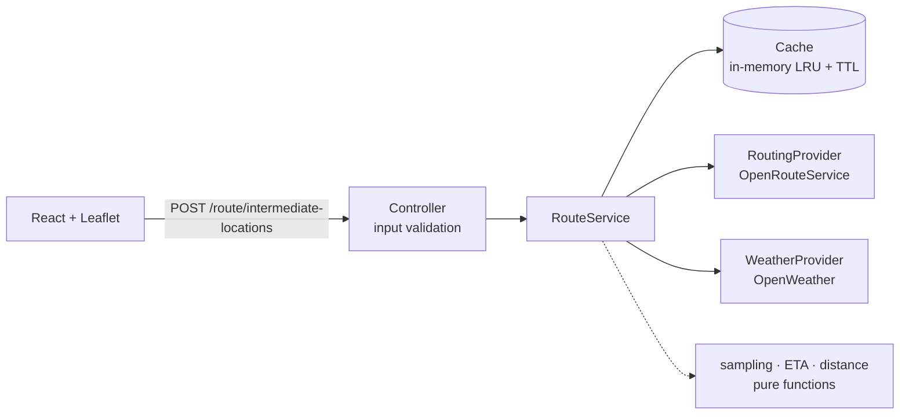

# RouteWeather

**Weather where you'll be, when you'll be there.** Pick a start and destination, and RouteWeather shows the forecast at points along your drive *for the time you'll reach each one*, not just the weather right now.

<!-- Add a screenshot: save it as docs/screenshot.png -->


**Live demo:** _coming soon_

## Features

- Place search with autocomplete (Photon / OpenStreetMap)
- Driving route from OpenRouteService, sampled into up to ~15 evenly spaced stops
- Choose when you leave: now or any time up to 4 days ahead
- Arrival time at every stop, using the routing engine's per-step durations
- Forecast for each stop matched to its arrival time (3-hour slots from OpenWeather)
- Interactive map (Leaflet) plus a weather timeline along the route

## Performance

Measured on Delhi → Jaipur (~270 km, 12 stops):

| | Latency |
|---|---|
| Before (sequential weather and geocoding calls) | 14.0 s, and repeated requests failed with **502** when Nominatim rate-limited us |
| After, cold | **1.5 s** |
| After, cached | **~3 ms** |

How:
1. **Dropped a redundant dependency.** OpenWeather's forecast response already includes the nearest locality, so the separate reverse-geocoding call per stop was removed. That halved the outside API calls and removed the rate limit behind the 502s.
2. **Parallel fetching.** Forecasts for all stops are requested at the same time with `Promise.all`.
3. **LRU + TTL cache.** Routes are cached for 24 h, storing only the geometry, step durations and total duration (not the full routing response). Forecasts are cached for 30 min, keyed by a ~1 km grid cell and 3-hour forecast slot, so nearby stops and repeat trips reuse entries. When the cache is full, the least recently used entry is evicted, so popular routes stay warm while one-off routes leave first.

## Architecture



- **Provider pattern + dependency injection.** `RouteService` depends on `RoutingProvider`, `WeatherProvider` and `Cache` interfaces. The concrete classes are wired in one place ([`container/dependencies.js`](Backend/container/dependencies.js)), so swapping OpenRouteService for another router, or the in-memory cache for Redis, means adding one class and touching no business logic. Tests use the same seam to inject fakes.
- **Core logic is pure functions.** Sampling, ETA and distance code ([`services/`](Backend/services), [`utils/`](Backend/utils)) has no I/O, so it is easy to unit-test.

### How it works

1. **Route.** OpenRouteService returns the road geometry and turn-by-turn steps with durations.
2. **ETA.** Cumulative haversine distance along the geometry. Each step's duration from the routing engine is spread across its points **by distance, not point count**, because route geometry is dense on curves and sparse on highways. If steps are missing, the total route duration is spread by distance instead.
3. **Sample by travel time.** A stop every N minutes of driving (≈ trip time ÷ 15, rounded up to 5 min, at least 10 min). The start and end are always included. Forecasts change over *time*, so a slow ghat or city stretch gets as many stops per hour as a fast highway. Sampling by distance would space stops unevenly in time. On Mysuru → Ooty, distance sampling gave gaps of 12–24 min; time sampling gives an even 20.
4. **Forecast.** For each stop, pick the OpenWeather 3-hour forecast closest to its arrival time.

## Reliability and security

- Input validation at the API boundary (coordinate type and range)
- Central error handler with typed `AppError`s: upstream failures become clean `502`s, and internals are never leaked
- Partial failures: if one stop's forecast fails, that stop returns `forecast: null` and the rest still arrive. Only when every stop fails does the request return a `502`
- 5 s timeouts on all upstream calls
- Rate limiting per client IP: 100 req / 15 min overall, 10 req / 15 min on the expensive route endpoint. `trust proxy` is set so the real client IP is used behind a hosting proxy (otherwise every user would share one bucket)
- CORS restricted to the frontend origin. Required env vars are checked at startup (fail fast)
- API keys stay on the server and are never logged
- Frontend shows a clear message for every failure (validation, rate limit, upstream error, network down)

## Tech stack

**Backend:** Node.js, Express 5, axios, express-rate-limit, `node:test`
**Frontend:** React 19, Vite, Tailwind CSS, React Leaflet
**APIs:** OpenRouteService (routing), OpenWeather (forecast), Photon (place search)

## Running locally

Requires Node 20+ and free API keys from [OpenRouteService](https://openrouteservice.org/dev/#/signup) and [OpenWeather](https://openweathermap.org/api).

```bash
# Backend
cd Backend
cp .env.example .env      # add ORS_API_KEY and OWM_API_KEY
npm install
npm start                 # http://localhost:3000
npm test

# Frontend (new terminal)
cd Frontend
cp .env.example .env      # VITE_API_URL=http://localhost:3000
npm install
npm run dev               # http://localhost:5173
```

### API

```http
POST /route/intermediate-locations
Content-Type: application/json

{
  "start": [77.209, 28.6139],            // [longitude, latitude]
  "end": [75.7873, 26.9124],
  "departAt": "2026-11-22T06:00:00Z"     // optional ISO time, defaults to now
}
```

`departAt` must be between now and 4 days ahead. OpenWeather's free forecast covers 5 days, so the extra day leaves room for the drive itself. Anything else gets a `400`.

Returns `{ results: [{ town, lat, lon, distance_km, arrival_time, forecast: { temperature, weather, windSpeed } | null }] }`. `forecast` is `null` for a stop whose forecast could not be fetched

## Trade-offs and next steps

- **The in-memory cache is per process.** Running more than one instance would need a shared cache. Redis can implement the existing `Cache` interface without changing the service.
- **ETAs don't include live traffic.** The free OpenRouteService tier doesn't provide it.
- **Forecast horizon is 5 days**, the limit of OpenWeather's free tier.
- Next: alerts for severe weather along the route.
